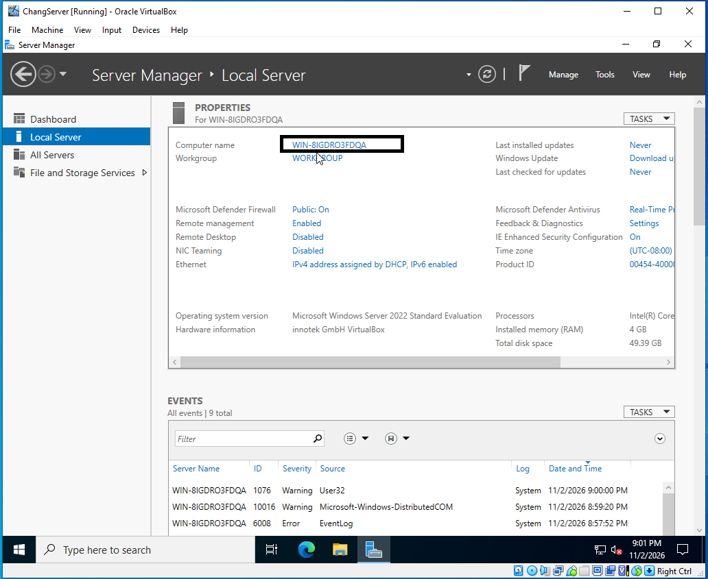
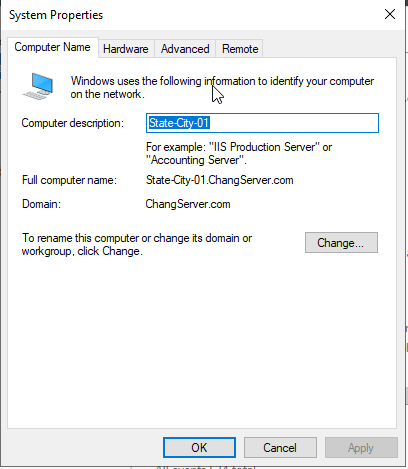
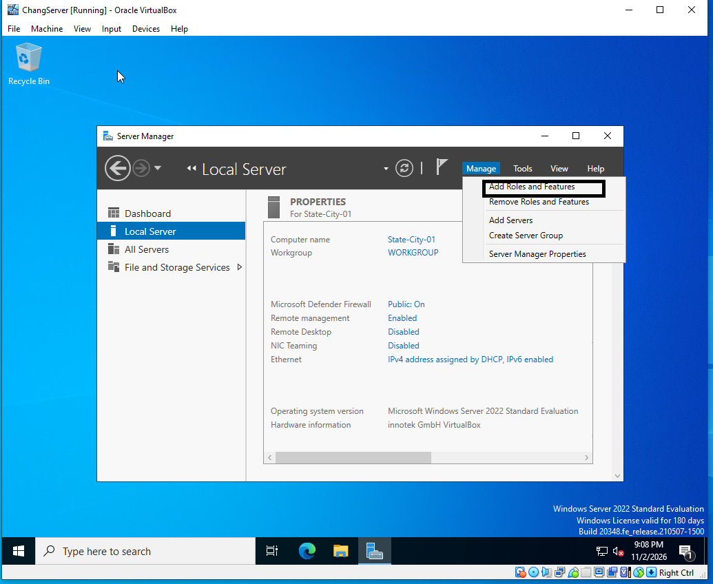
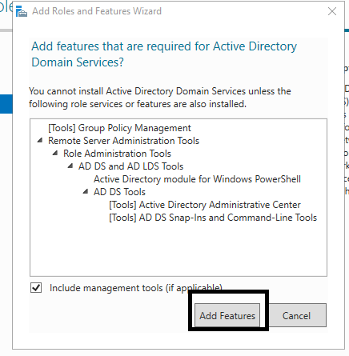
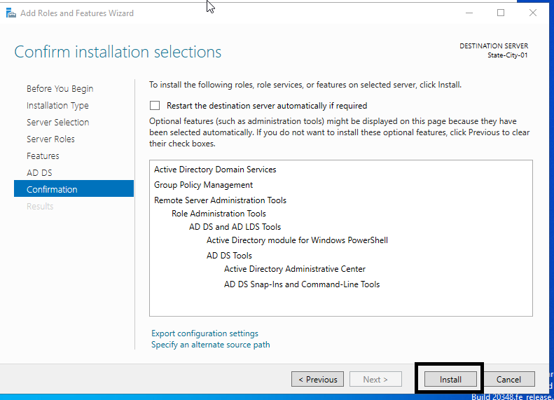
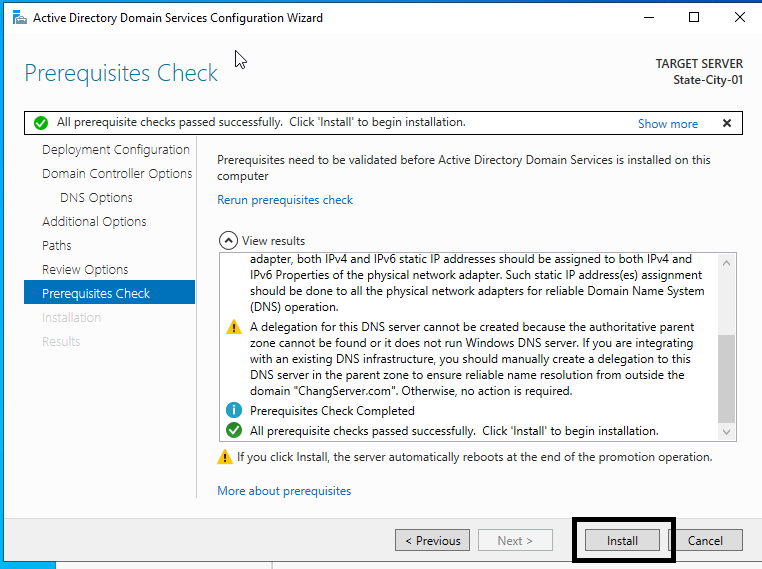
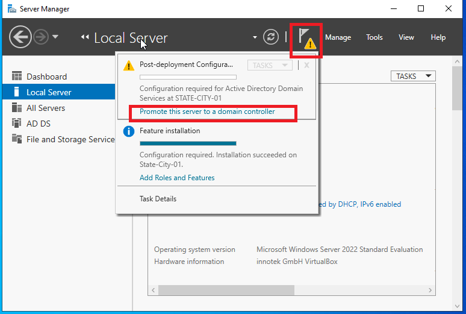
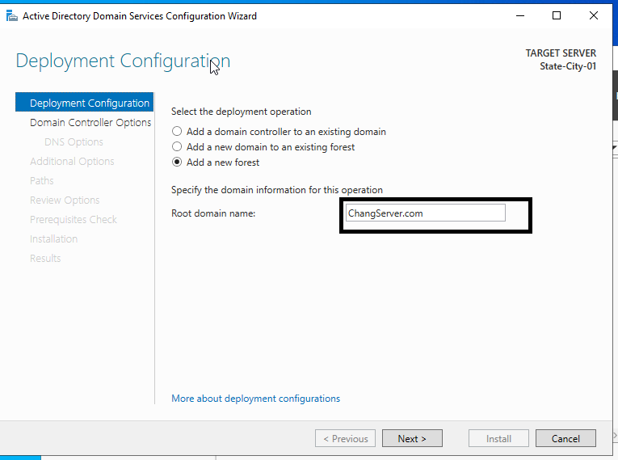
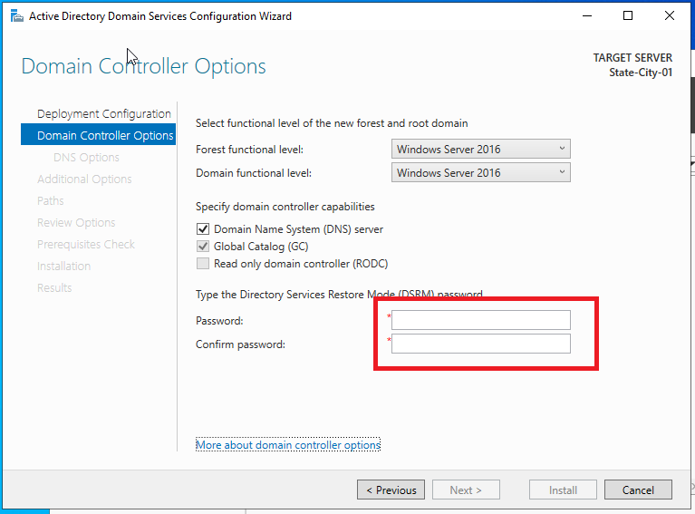
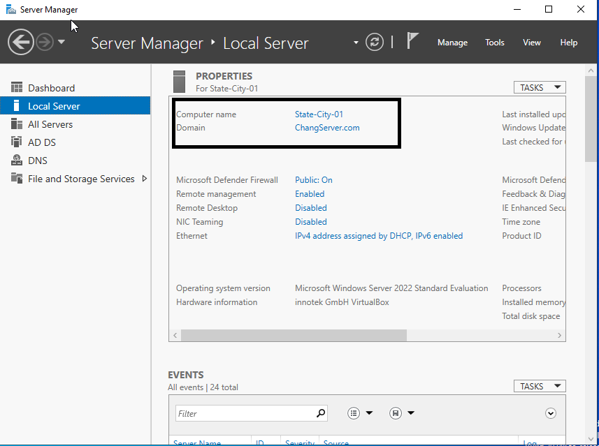

# ADD-Setup

Active Directory Domain Services (AD DS) and Domain Controller Setup using Windows Server 2022.

## Requirements

1. You must already have Windows Server 2022 installed on VirtualBox.
2. If you have not installed it yet, follow my [Windows Server 2022 Installation Guide](https://github.com/ChangITTech/WindowServer2022Setup).

## Step-by-Step Tutorial

Click on any step below to expand or collapse its instructions and screenshots.

<strong>Step 1: Open Server Manager</strong>

Open Server Manager and navigate to the landing page.

Here, we are going to change the computer name to provide context for the server.

Click on the current computer name to begin the renaming process.

<strong>Step 2: Rename the Computer</strong>

Here, we can rename the computer.

A good practice is to use a descriptive naming convention that provides context about the server.

For example:

**State-City-1**

You can create a name based on your geographic location or the server's purpose.

<strong>Step 3: Add Roles and Features</strong>

Once the computer has been renamed, return to the Server Manager dashboard.

Locate and click **Add roles and features**.

<strong>Step 4: Select Active Directory Domain Services</strong>

After clicking **Add roles and features**, proceed through the wizard.

1. Select **Role-based or feature-based installation**.
2. Select your Windows Server.
3. Navigate to **Server Roles**.
4. Check **Active Directory Domain Services (AD DS)**.

<strong>Step 5: Add Required Features</strong>

When prompted to install additional features required by Active Directory Domain Services, click **Add Features**.

Continue through the installation wizard.

<strong>Step 6: Install Active Directory Domain Services</strong>

Confirm the selected roles and features.

Click **Install** to begin installing Active Directory Domain Services.

Wait for the installation to finish.

<strong>Step 7: Promote the Server to a Domain Controller</strong>

Once Active Directory Domain Services has finished installing, the next step is to promote the server to a domain controller.

1. Open Server Manager.
2. Click the notification flag icon.
3. Select **Promote this server to a domain controller**.

<strong>Step 8: Create a New Forest</strong>

The Active Directory Domain Services Configuration Wizard will open.

Since we are creating a new Active Directory environment:

1. Select **Add a new forest**.
2. Enter a root domain name of your choice.
3. Click **Next**.

For a home lab, you can use a subdomain of a domain you own or a name under a reserved testing domain such as `example.test`.

<strong>Step 9: Configure Domain Controller Options</strong>

On the Domain Controller Options page, configure the required settings.

Create a strong **Directory Services Restore Mode (DSRM)** password.

This password is used for Active Directory recovery and maintenance.

Keep the password secure and click **Next**.

<strong>Step 10: Run Prerequisites Check and Install</strong>

After configuring the domain controller options, continue through the wizard.

1. Review the DNS options.
2. Confirm the NetBIOS domain name.
3. Review the Active Directory database, log, and SYSVOL paths.
4. Review your configuration.
5. Wait for the **Prerequisites Check** to complete.
6. If all required checks pass, click **Install**.

Windows Server will install the domain controller configuration.

After installation, the server will automatically restart.

<strong>Step 11: Verify Active Directory Installation</strong>

After the server restarts, log in and open Server Manager.

Verify that the domain name matches the one you configured earlier.

You can also confirm that Active Directory Domain Services is installed and that the server is functioning as a domain controller.

Congratulations! You have successfully configured an Active Directory domain controller on Windows Server 2022.

## Afterthoughts: What I Learned

This project helped me understand the fundamentals of Active Directory Domain Services (AD DS) and the role of a domain controller in a Windows Server environment.

I learned how to:

- Rename a Windows Server computer.
- Install Active Directory Domain Services.
- Promote Windows Server 2022 to a domain controller.
- Create a new Active Directory forest and domain.
- Configure domain controller settings.
- Verify a successful Active Directory installation.

One important concept I learned is that a domain controller provides centralized authentication and directory services for computers and users within an Active Directory domain.

Authorized computers can join the domain, allowing administrators to centrally manage user accounts, authentication, and access to network resources.

This project is part of my hands-on IT homelab experience and helps me develop foundational skills in Windows Server administration, Active Directory, and IT infrastructure management.
